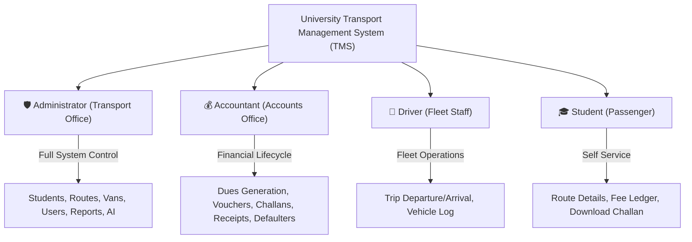
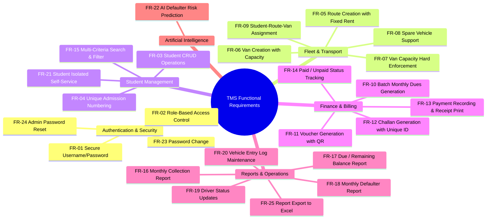
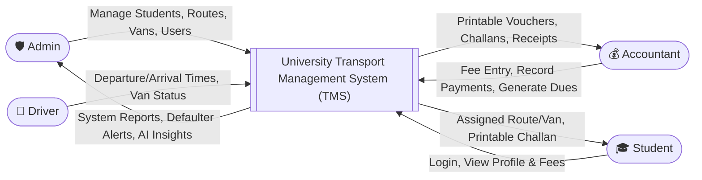
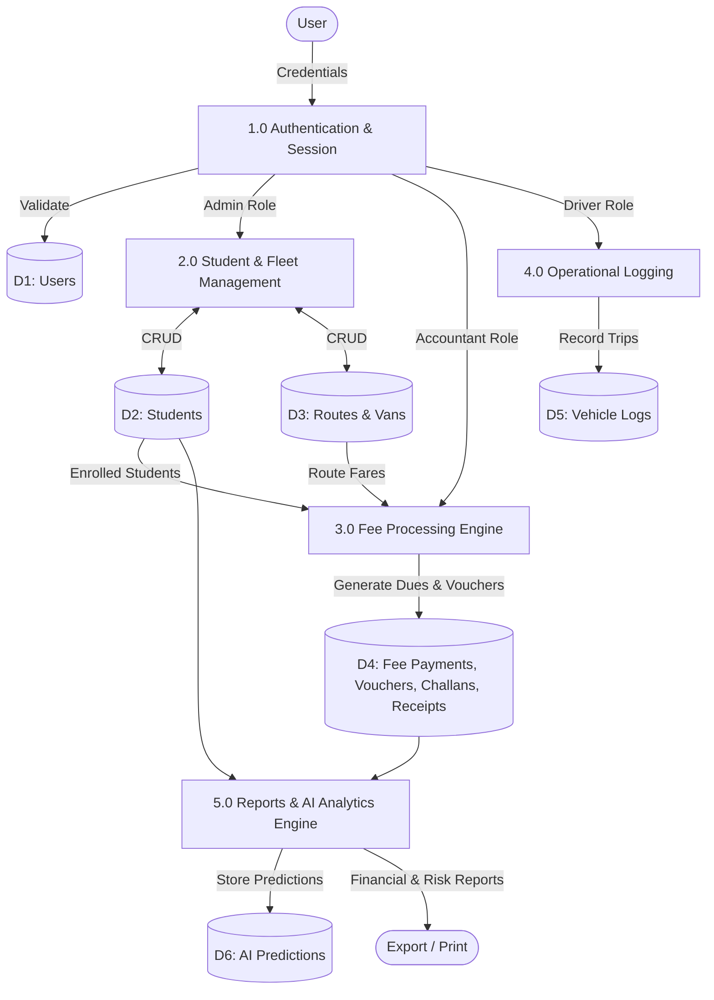
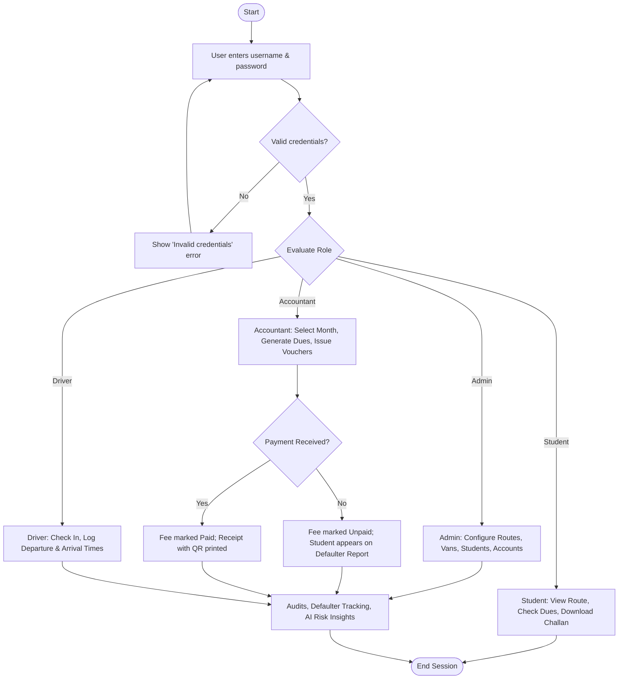
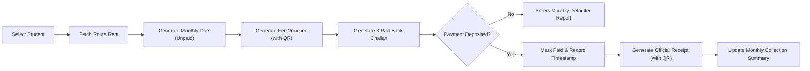
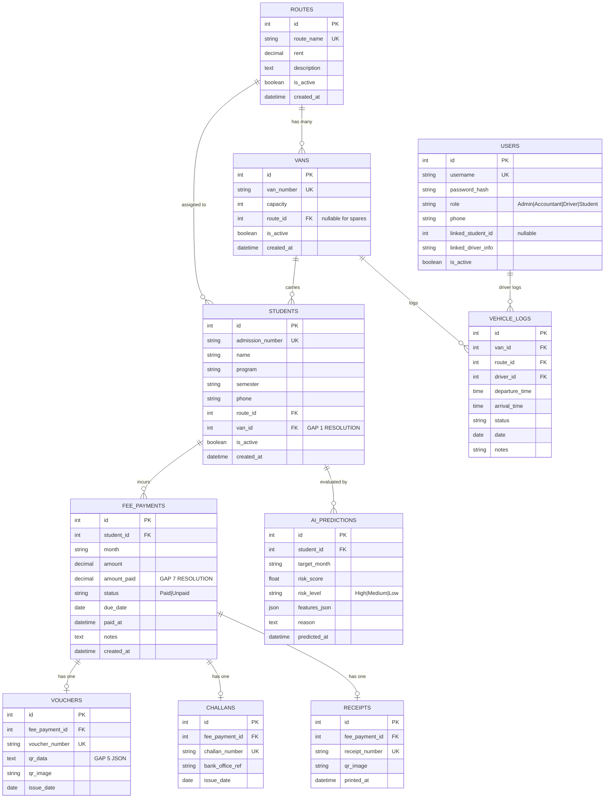
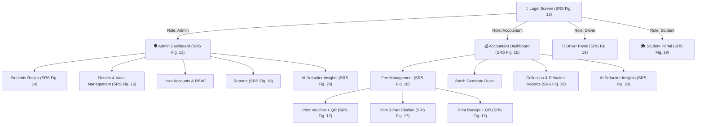

# Software Requirements and System Design Specification (SRS & SDS)
## University Transport Management System (TMS) with AI-Based Defaulter Prediction

**Project Code:** TMS-FYP-2026  
**Department:** Department of Information Technology, Government College University Faisalabad (GCUF)  
**Document Standard:** IEEE Std 830-1998 & ISO/IEC/IEEE 29148:2018  
**Document Version:** 1.0 (Master Final Draft)  
**Status:** Approved Specification  

---

### Document Information

| Field | Description |
|---|---|
| **Customer** | University Transport Office / Accounts Office, GCUF |
| **Project Title** | University Transport Management System (TMS) |
| **Academic Context** | Final Year Project (FYP-2026) |
| **Team Size** | 2 Developers (Developer A: Transport + Operations; Developer B: Finance + Students) |
| **Supervision** | Department of Information Technology, GCUF |

---

### Definition of Terms, Acronyms and Abbreviations

| Term / Acronym | Description |
|---|---|
| **TMS** | Transport Management System |
| **FYP** | Final Year Project |
| **SRS** | Software Requirements Specification |
| **SDS** | System Design Specification |
| **BR / UR** | Business Requirement / User Requirement |
| **FR / NFR** | Functional Requirement / Non-Functional Requirement |
| **UC** | Use Case |
| **ERD** | Entity Relationship Diagram |
| **DFD** | Data Flow Diagram |
| **RBAC** | Role-Based Access Control |
| **QR** | Quick Response code (2D matrix barcode used on documents) |
| **Challan** | Bank / Accounts office payment slip used to deposit fee in triplicate |
| **Voucher** | Monthly fee voucher issued to the student with embedded QR verification |
| **Defaulter** | An active transport student whose monthly dues remain unpaid past due date |
| **Spare Vehicle**| An unassigned overflow vehicle used when route capacity is exhausted |

---

## 1. Introduction

### 1.1 Purpose
The purpose of this document is to provide a complete, unambiguous specification of the requirements and architectural design for the **University Transport Management System (TMS) with AI-Based Defaulter Prediction**. The system digitizes university fleet operations, student seat allocations, automated monthly fee processing, voucher/challan/receipt issuance with QR verification, and introduces an AI module for proactive defaulter risk classification.

### 1.2 Problem Statement
University transport serves hundreds of students across multiple geographical routes. Each route has its own fixed monthly rent, each vehicle/van has a strict passenger capacity limit (20–22 seats), and transport dues are collected monthly. Currently:
1. **Manual Records:** Student allocations, route mappings, and vehicle logs are managed in paper registers or disconnected Excel spreadsheets.
2. **Billing Errors:** Manual calculation mistakes occur frequently when reconciling route rents and monthly dues.
3. **Lost / Duplicate Records:** Challans and receipts are handwritten, leading to lost vouchers and duplicate entries.
4. **Delayed Defaulter Recovery:** Accounts staff lack instant visibility into unpaid students, delaying revenue collection.
5. **No Predictive Insights:** Management cannot anticipate which students are at high risk of payment default.

### 1.3 Project Scope
* **In Scope:**
  * Multi-role authentication & Role-Based Access Control (Admin, Accountant, Driver, Student).
  * Student enrollment and registration with unique admission numbers.
  * Route creation with route-specific monthly fare/rent.
  * Vehicle and van management with hard capacity enforcement (20–22 seats) and spare vehicle handling.
  * Student-to-route and student-to-van allocation with real-time seat availability checks.
  * Automated batch generation of monthly transport dues.
  * Generation and printing of fee vouchers with verifiable QR code.
  * Generation and printing of 3-part bank challans (Bank, Office, Student copies).
  * Payment recording, status toggle (Unpaid $\rightarrow$ Paid), and official receipt generation with QR verification.
  * Multi-criteria search and filtering across students, routes, vans, months, and payment statuses.
  * Management reporting: Monthly Collection Report, Due/Remaining Report, and Monthly Defaulter Report with Excel export.
  * Driver panel for logging trip departures, arrivals, and operational statuses into the Vehicle Entry Log.
  * Student self-service portal to view assigned route, van, fee ledger, and download unpaid challans.
  * AI module for predicting student default probabilities using historical payment patterns.

* **Out of Scope (v1):**
  * Real-time GPS vehicle tracking (planned for future hardware rollout).
  * Direct payment gateway integration (university operates via official bank challan deposits).
  * Native mobile app (system is built as a fully responsive web application).

---

## 2. Overall Description

### 2.1 Stakeholder & Role Matrix



| Role | Description & Responsibilities |
|---|---|
| **Admin** | Full system authority. Manages student enrollments, creates routes with rents, manages vans and capacity limits, manages user accounts and passwords, views all reports, audits vehicle logs, and reviews AI predictions. |
| **Accountant** | Financial controller. Executes monthly dues batch generation, issues fee vouchers with QR codes, generates bank challans, records fee payments, issues receipts, monitors defaulters, and exports financial reports. |
| **Driver** | Operational personnel. Logs daily trip departures and arrivals, marks operational status (Scheduled, Departed, On Route, Arrived, Off), and maintains the university vehicle entry log. |
| **Student** | Transport beneficiary. Inspects assigned route, assigned van number, monthly fare, checks payment history (Paid / Unpaid), and downloads digital payment challans. Isolated strictly to own records. |

### 2.2 Assumptions and Dependencies
1. Intranet / LAN / Internet connectivity is available at the university transport and accounts desks.
2. Route rents and vehicle capacities are decided by university administration and configured by the Admin.
3. Each standard university van has a physical capacity of 20 to 22 passenger seats.
4. Challan deposits are settled physically or via designated university bank counters.

---

## 3. Specific System Requirements

### 3.1 Business Requirements [BR]

| ID | Description |
|---|---|
| **BR-1** | Implement a centralized web-based system that replaces manual registers and Excel sheets. |
| **BR-2** | Ensure high usability and clear navigation for non-technical administrative staff, drivers, and students. |
| **BR-3** | Eliminate financial discrepancies and fee calculation errors through automated route-rent reconciliation. |
| **BR-4** | Deliver actionable real-time reports to administration for fleet utilization and revenue recovery decisions. |

---

### 3.2 User Requirements [UR]

#### Administrator
| ID | Requirement Statement |
|---|---|
| **UR-01** | As an Admin, I shall be able to log in securely and update my password. |
| **UR-02** | As an Admin, I shall be able to create, edit, delete user accounts, and assign roles (Admin, Accountant, Driver, Student). |
| **UR-03** | As an Admin, I shall be able to add, edit, delete, and view student records. |
| **UR-04** | As an Admin, I shall be able to create and modify transport routes with fixed monthly rents. |
| **UR-05** | As an Admin, I shall be able to register vans and designate standby spare vehicles with seat capacities. |
| **UR-06** | As an Admin, I shall be able to assign students to a route and specific van with capacity enforcement. |
| **UR-07** | As an Admin, I shall be able to filter students by name, program, semester, route, van, fee status, and admission number. |
| **UR-08** | As an Admin, I shall be able to review all financial, operational, and collection reports. |
| **UR-09** | As an Admin, I shall be able to inspect AI defaulter risk predictions and historical justifications. |

#### Accountant
| ID | Requirement Statement |
|---|---|
| **UR-10** | As an Accountant, I shall be able to log in to access the financial portal. |
| **UR-11** | As an Accountant, I shall be able to execute automated batch dues generation for any selected month. |
| **UR-12** | As an Accountant, I shall be able to generate and print fee vouchers with verifiable QR codes. |
| **UR-13** | As an Accountant, I shall be able to generate and print 3-part bank challans. |
| **UR-14** | As an Accountant, I shall be able to record fee payments against challan numbers and print official receipts. |
| **UR-15** | As an Accountant, I shall be able to generate monthly collection reports, remaining due lists, and defaulter reports. |

#### Driver
| ID | Requirement Statement |
|---|---|
| **UR-16** | As a Driver, I shall be able to log in and access my mobile-friendly driver panel. |
| **UR-17** | As a Driver, I shall be able to update vehicle operational status (Departed, On Route, Arrived, Off). |
| **UR-18** | As a Driver, I shall be able to record daily departure and arrival timestamps for trips. |

#### Student
| ID | Requirement Statement |
|---|---|
| **UR-19** | As a Student, I shall be able to log in to my self-service portal. |
| **UR-20** | As a Student, I shall be able to view my assigned route, assigned van registration number, and monthly fare. |
| **UR-21** | As a Student, I shall be able to inspect my monthly fee ledger (Paid/Unpaid) and download printable challans for unpaid months. |

---

### 3.3 Functional Requirements [FR]



| ID | Functional Requirement Description |
|---|---|
| **FR-01** | The system shall authenticate users via unique username and password. |
| **FR-02** | The system shall restrict navigation, views, and actions based on user roles (Admin, Accountant, Driver, Student). |
| **FR-03** | The system shall allow the Admin to add, update, delete, and view student profiles. |
| **FR-04** | The system shall enforce unique admission numbers for each student (e.g., `2022-101`). |
| **FR-05** | The system shall allow the Admin to create transport routes with associated monthly rents. |
| **FR-06** | The system shall allow the Admin to register vans with registration numbers and seat capacities (20–22 seats). |
| **FR-07** | The system shall automatically block student assignment when a van's capacity is full and prompt selection of another van or spare vehicle. |
| **FR-08** | The system shall support unassigned standby spare vehicles for overflow allocation during high demand. |
| **FR-09** | The system shall map each active student to both a route and a van. |
| **FR-10** | The system shall generate monthly dues for all assigned students equal to their route rent. |
| **FR-11** | The system shall generate fee vouchers embedding an offline-verifiable QR code. |
| **FR-12** | The system shall generate a bank challan with a guaranteed unique challan tracking reference. |
| **FR-13** | The system shall record fee payments and generate printable official receipts with verification QR codes. |
| **FR-14** | The system shall track and toggle the payment status of each monthly fee record as Paid or Unpaid. |
| **FR-15** | The system shall provide search and filter capabilities across name, program, semester, route, van, fee status, month, and admission number. |
| **FR-16** | The system shall generate a Monthly Collection Report aggregating collected and remaining funds per route. |
| **FR-17** | The system shall generate a Due / Remaining Report displaying outstanding student balances. |
| **FR-18** | The system shall generate a Monthly Defaulter Report listing unpaid students, months overdue, and total due amounts. |
| **FR-19** | The system shall allow drivers to update trip status and operational notes from their dashboard. |
| **FR-20** | The system shall maintain a persistent Vehicle Entry Log tracking van movements, driver shifts, and timings. |
| **FR-21** | The system shall allow students to view only their own assigned transport details and fee history. |
| **FR-22** | The system shall analyze historical payment records using machine learning to predict student default risk (High, Medium, Low). |
| **FR-23** | The system shall allow authenticated users to change their own passwords securely. |
| **FR-24** | The system shall allow the Administrator to reset passwords for any user account. |
| **FR-25** | The system shall allow reports to be printed and exported to Microsoft Excel (`.xlsx`) format. |

---

### 3.4 Non-Functional Requirements [NFR]

#### 3.4.1 Usability
* **NFR-U1:** A newly appointed accountant shall complete a fee payment entry (voucher $\rightarrow$ receipt) in under 5 minutes without technical assistance.
* **NFR-U2:** All core functional tasks shall be accessible within 3 mouse clicks from the primary role dashboard.
* **NFR-U3:** The system shall display informative, actionable validation messages (e.g., *"Van LEA-101 is full (22/22 seats). Please assign another vehicle or spare van."*).
* **NFR-U4:** The web interface shall be responsive and fully functional across desktop monitors, tablets, and smartphones.
* **NFR-U5:** All printed outputs (vouchers, challans, receipts) shall conform to standardized university visual identity and typography.

#### 3.4.2 Reliability & Data Integrity
* **NFR-R1:** Availability shall achieve 99% uptime during university operating hours (07:00 – 17:00 PKT).
* **NFR-R2:** Automated database backup scripts shall execute daily.
* **NFR-R3:** Voucher numbers (`VCH-XXXXXXXX`), challan numbers (`CHN-XXXXXXXX`), and receipt numbers (`RCT-XXXXXXXX`) shall be guaranteed unique and non-repeating across the system lifecycle.
* **NFR-R4:** Fee calculations must be 100% mathematically consistent with route rent schedules.
* **NFR-R5:** Atomic database transactions must ensure zero partial records are stored upon operation failure.

#### 3.4.3 Performance & Scalability
* **NFR-P1:** Search and filter queries shall return results within 3.0 seconds for datasets up to 5,000 student records.
* **NFR-P2:** Document generation (voucher, challan, receipt) including QR matrix generation shall complete in under 5.0 seconds.
* **NFR-P3:** Aggregate financial and defaulter reports shall compile in under 10.0 seconds.
* **NFR-P4:** The system shall support at least 50 concurrent active users without degradation.

#### 3.4.4 Security
* **NFR-S1:** Passwords shall be cryptographically hashed using PBKDF2 with SHA-256 (never stored in plaintext).
* **NFR-S2:** Role-based access control decorators shall enforce server-side route guards on all HTTP endpoints, returning HTTP 403 Forbidden on violation.
* **NFR-S3:** User sessions shall automatically terminate after 30 minutes of inactivity.
* **NFR-S4:** Student data access shall be strictly isolated via object-level filtering (`request.user.linked_student_id`).
* **NFR-S5:** All input forms shall be validated and sanitized against SQL Injection (ORM parameterized queries) and Cross-Site Scripting (XSS).

#### 3.4.5 Supportability & Maintainability
* **NFR-M1:** Codebase architecture shall maintain strict domain separation (`accounts`, `students`, `transport`, `finance`, `operations`, `reports`, `ai_predictor`).
* **NFR-M2:** Python code shall adhere to PEP 8 standards with type annotations and docstrings.
* **NFR-M3:** Source code shall be versioned using Git with semantic commit conventions.
* **NFR-M4:** Vehicle capacities, route fares, and billing parameters shall be dynamic and configurable through the UI without code modifications.

---

## 4. System Architecture

### 4.1 Three-Tier Architecture
The system adopts a classical, clean **Three-Tier Architecture**:

```mermaid
graph TB
    subgraph Presentation Layer
        UI1["Admin Dashboard"]
        UI2["Finance & Billing Portal"]
        UI3["Driver Trip Panel"]
        UI4["Student Self-Service Portal"]
    end

    subgraph Application & Business Logic Layer
        Auth["Auth & RBAC Middleware"]
        StudentSvc["Student Allocation Engine"]
        TransportSvc["Fleet & Capacity Controller"]
        FinanceSvc["Dues & QR Billing Pipeline"]
        AISvc["Scikit-Learn Prediction Engine"]
        ReportSvc["Reporting & Excel Aggregator"]
    end

    subgraph Data Layer
        DB[("Relational Database (SQLite / PostgreSQL)\n10 Tables with Strict Foreign Keys")]
        Media[("Media Storage\nQR Code Image Assets")]
        MLStore[("Model Store\nSerialized Defaulter Pipeline")]
    end

    Presentation Layer --> |"HTTP / HTTPS Request"| Application & Business Logic Layer
    Application & Business Logic Layer --> |"ORM / SQL Queries"| Data Layer
```

---

### 4.2 Data Flow Diagrams

#### Level 0: Context Diagram


#### Level 1: Subsystem Data Flow


---

### 4.3 End-to-End System Workflows

#### Overall Lifecycle Workflow


#### Monthly Fee Pipeline Flowchart


---

## 5. Detailed Use Cases

### 5.1 Use Case Summary (All 22 Use Cases)

| UC ID | Use Case Name | Primary Actor | Priority | Included / Extended By |
|---|---|---|---|---|
| **UC-01** | Login | All Users | High | `<<include>>` Authenticate |
| **UC-02** | Change / Forgot Password | All Users | Medium | `<<extend>>` Login |
| **UC-03** | Manage Users & RBAC | Admin | High | — |
| **UC-04** | Manage Students | Admin | High | — |
| **UC-05** | Manage Routes & Rent | Admin | High | — |
| **UC-06** | Manage Vans & Spare Vehicles | Admin | High | — |
| **UC-07** | Assign Student to Route / Van | Admin | High | `<<include>>` Check Van Capacity |
| **UC-08** | Generate Monthly Dues | Accountant | High | `<<include>>` Fetch Route Rent |
| **UC-09** | Generate Voucher with QR | Accountant | High | `<<include>>` Generate QR |
| **UC-10** | Generate Challan | Accountant | High | — |
| **UC-11** | Record Payment | Accountant | High | `<<extend>>` Print Receipt |
| **UC-12** | Print Receipt | Accountant | High | — |
| **UC-13** | Search & Filter Records | Admin, Accountant | Medium | — |
| **UC-14** | Monthly Collection Report | Admin, Accountant | Medium | — |
| **UC-15** | Due / Remaining Report | Admin, Accountant | Medium | — |
| **UC-16** | Defaulter Report | Admin, Accountant | High | — |
| **UC-17** | View Vehicle Entry Log | Admin | Medium | — |
| **UC-18** | Update Van / Route Status | Driver | Medium | `<<include>>` Write Vehicle Log |
| **UC-19** | View Own Route & Fee Status | Student | High | — |
| **UC-20** | Download Own Challan | Student | High | — |
| **UC-21** | AI Defaulter Prediction | Admin, Accountant | High | — |
| **UC-22** | Logout | All Users | High | — |

---

### 5.2 Detailed Use Case Specifications

#### UC-01: Login
* **Actor:** Admin, Accountant, Driver, Student
* **Precondition:** User holds an active username and password.
* **Main Success Scenario:**
  1. User accesses application URL and sees login form.
  2. User inputs username and password.
  3. System checks password hash using PBKDF2-SHA256.
  4. System establishes session and redirects user to their dedicated role dashboard (Admin, Accountant, Driver, or Student).
* **Exception:** Invalid credentials $\rightarrow$ System displays *"Invalid username or password"*.

#### UC-04: Manage Students
* **Actor:** Admin
* **Precondition:** Admin is authenticated.
* **Main Success Scenario:**
  1. Admin navigates to "Students" screen.
  2. Admin clicks "Add Student" and inputs admission number, name, program, semester, and phone.
  3. System validates uniqueness of admission number and commits record.
* **Exception:** Duplicate admission number $\rightarrow$ System rejects with *"Admission number already exists"*.

#### UC-06: Manage Vans / Spare Vehicles
* **Actor:** Admin
* **Precondition:** Admin is authenticated.
* **Main Success Scenario:**
  1. Admin navigates to "Vans" management screen.
  2. Admin clicks "Add Van" and enters registration number (e.g., `LEA-101`), capacity (20–22), and selects assigned route or designates as "Spare".
  3. System saves vehicle and displays in fleet roster.
* **Exception:** Duplicate van number $\rightarrow$ System rejects with validation error.

#### UC-07: Assign Student to Route / Van (GAP 1 FIX)
* **Actor:** Admin
* **Precondition:** Student profile, Route, and Van exist.
* **Main Success Scenario:**
  1. Admin selects a student and opens assignment screen.
  2. Admin selects Route and specific Van.
  3. System queries van seat occupancy (`students.filter(is_active=True).count()`).
  4. If occupied seats $<$ capacity, system saves `route_id` and `van_id` on Student record.
* **Exception:** Van is at maximum capacity $\rightarrow$ System blocks assignment and displays: *"Van LEA-101 is full (22/22 seats). Please assign another van or an available spare vehicle."*

#### UC-08: Generate Monthly Dues
* **Actor:** Accountant
* **Precondition:** Active students are assigned to routes with defined rents.
* **Main Success Scenario:**
  1. Accountant selects "Generate Monthly Dues" and enters target month (e.g., "Nov 2026").
  2. System iterates through all active students with assigned routes.
  3. System automatically creates a `FeePayment` record with `amount = student.route.rent`, `amount_paid = 0`, and `status = Unpaid`.
* **Exception:** Existing record for the same student and month $\rightarrow$ System skips to prevent duplicate charges.

#### UC-09: Generate Voucher with QR (GAP 5 FIX)
* **Actor:** Accountant
* **Precondition:** An unpaid fee payment record exists.
* **Main Success Scenario:**
  1. Accountant locates student and clicks "Generate Voucher".
  2. System generates a unique `voucher_number` (`VCH-XXXXXXXX`).
  3. System creates a standalone, verifiable JSON payload:
     ```json
     {
       "type": "voucher",
       "doc_number": "VCH-2026-001234",
       "student": "Ali Khan",
       "admission": "2022-101",
       "amount": 5000.0,
       "month": "Nov 2026",
       "status": "Unpaid",
       "generated_at": "2026-11-05T12:00:00"
     }
     ```
  4. System renders the QR code PNG image and displays the printable voucher sheet.

#### UC-11: Record Payment
* **Actor:** Accountant
* **Precondition:** Fee payment record exists and student has deposited funds.
* **Main Success Scenario:**
  1. Accountant searches by student admission number or challan number.
  2. Accountant inputs amount paid and optional transaction remarks.
  3. System updates payment record: `amount_paid = amount`, `status = Paid`, and `paid_at = now()`.
  4. System auto-generates official `Receipt` with unique receipt number (`RCT-XXXXXXXX`) and verifiable QR code.
* **Exception:** Fee already paid $\rightarrow$ System notifies: *"This month is already settled."*

#### UC-16: Defaulter Report
* **Actor:** Admin, Accountant
* **Precondition:** Monthly dues exist in the database.
* **Main Success Scenario:**
  1. User navigates to Reports $\rightarrow$ Defaulters.
  2. User selects target billing month.
  3. System compiles all students with `status = Unpaid` for that month.
  4. System calculates each student's historical unpaid months count and total cumulative arrears.
  5. User can print the report or export to Microsoft Excel (`.xlsx`).

#### UC-18: Update Van / Route Status
* **Actor:** Driver
* **Precondition:** Driver is authenticated and assigned to duty.
* **Main Success Scenario:**
  1. Driver opens the Driver Panel.
  2. Driver selects assigned vehicle, route, enters departure time and arrival time, and selects operational status (*On Route*, *Arrived*, *Departed*, or *Off*).
  3. System saves the entry to the persistent `VehicleLog`.

#### UC-19 & UC-20: Student Portal & Challan Download
* **Actor:** Student
* **Precondition:** Student is authenticated.
* **Main Success Scenario:**
  1. Student logs in and arrives at the Student Portal.
  2. System displays assigned route name, van registration number, and monthly fare.
  3. System displays table of monthly dues.
  4. For any unpaid month, student clicks "Download Challan" to open the printable 3-part bank deposit slip.

#### UC-21: AI Defaulter Prediction (GAP 4 FIX)
* **Actor:** Admin, Accountant
* **Precondition:** At least two billing cycles of payment history exist in the system.
* **Main Success Scenario:**
  1. User navigates to "AI Insights".
  2. User inputs upcoming target month (e.g., "Dec 2026") and clicks "Run Prediction".
  3. System extracts historical features per student (total months, paid months, unpaid months, payment ratio, consecutive default streak, route rent, semester).
  4. Prediction pipeline evaluates features and computes a probability score (0.0 to 1.0).
  5. System classifies students into High ($\ge 0.70$), Medium ($0.40 - 0.69$), or Low ($< 0.40$) risk with human-readable explanations.

---

## 6. Detailed System Design & Database Schema

### 6.1 Corrected Entity Relationship Diagram (ERD)



---

### 6.2 Relational Database Schema Specifications (10 Tables)

#### 1. `ROUTES` Table
| Column | Type | Constraints | Description |
|---|---|---|---|
| `id` | Integer | PK, Auto Increment | Unique route identifier |
| `route_name` | Varchar(200) | Unique, Not Null | Full route name (e.g., "Daska - GCUF") |
| `rent` | Decimal(10,2) | Not Null | Fixed monthly fare in PKR |
| `description` | Text | Nullable | Optional route stops and itinerary |
| `is_active` | Boolean | Default True | Active operational status |
| `created_at` | DateTime | Auto Now Add | Record timestamp |

#### 2. `VANS` Table
| Column | Type | Constraints | Description |
|---|---|---|---|
| `id` | Integer | PK, Auto Increment | Unique vehicle identifier |
| `van_number` | Varchar(50) | Unique, Not Null | Registration number (e.g., `LEA-101`) |
| `capacity` | Integer | Not Null, Default 22 | Physical passenger capacity (20–22 seats) |
| `route_id` | Integer | FK $\rightarrow$ ROUTES.id, Nullable | Assigned route (`NULL` = Spare Vehicle) |
| `is_active` | Boolean | Default True | Operational status |
| `created_at` | DateTime | Auto Now Add | Record timestamp |

#### 3. `STUDENTS` Table
| Column | Type | Constraints | Description |
|---|---|---|---|
| `id` | Integer | PK, Auto Increment | Unique student record ID |
| `admission_number`| Varchar(50) | Unique, Indexed, Not Null| University admission number (e.g., `2022-101`) |
| `name` | Varchar(200) | Indexed, Not Null | Student's full name |
| `program` | Varchar(100) | Not Null | Degree program (e.g., BSIT, BSCS) |
| `semester` | Varchar(20) | Not Null | Current semester (e.g., 1st, 5th) |
| `phone` | Varchar(20) | Nullable | Contact telephone number |
| `route_id` | Integer | FK $\rightarrow$ ROUTES.id, Nullable | Assigned daily travel route |
| `van_id` | Integer | FK $\rightarrow$ VANS.id, Nullable | Assigned specific van (GAP 1 FIX) |
| `is_active` | Boolean | Default True | Transport subscription status |
| `created_at` | DateTime | Auto Now Add | Registration timestamp |

#### 4. `USERS` Table (Custom AbstractUser)
| Column | Type | Constraints | Description |
|---|---|---|---|
| `id` | Integer | PK, Auto Increment | Primary user ID |
| `username` | Varchar(150) | Unique, Not Null | Login username |
| `password` | Varchar(128) | Not Null | Cryptographic PBKDF2-SHA256 password hash |
| `role` | Varchar(20) | Not Null, Default 'Student'| Role: `Admin`, `Accountant`, `Driver`, `Student` |
| `phone` | Varchar(20) | Nullable | User contact phone number |
| `linked_student_id`| Integer | Nullable | FK link to STUDENTS.id for Student role |
| `linked_driver_info`| Varchar(100) | Nullable | Vehicle / driver identifier for Driver role |
| `is_active` | Boolean | Default True | Account enabled flag |

#### 5. `FEE_PAYMENTS` Table
| Column | Type | Constraints | Description |
|---|---|---|---|
| `id` | Integer | PK, Auto Increment | Fee payment record ID |
| `student_id` | Integer | FK $\rightarrow$ STUDENTS.id, Not Null| Linked student |
| `month` | Varchar(20) | Indexed, Not Null | Billing month (e.g., "November 2026") |
| `amount` | Decimal(10,2) | Not Null | Full monthly route rent |
| `amount_paid` | Decimal(10,2) | Default 0.00 | Amount settled to date (GAP 7 FIX) |
| `status` | Varchar(10) | Not Null, Default 'Unpaid' | Payment status: `Paid` or `Unpaid` |
| `due_date` | Date | Nullable | Due date for payment deposit |
| `paid_at` | DateTime | Nullable | Timestamp when payment was confirmed |
| `notes` | Text | Nullable | Transaction notes / remarks |
| `created_at` | DateTime | Auto Now Add | Record creation timestamp |
| *Composite Unique*| (`student_id`, `month`) | Unique Constraint | Prevents duplicate billing in the same month |

#### 6. `VOUCHERS` Table
| Column | Type | Constraints | Description |
|---|---|---|---|
| `id` | Integer | PK, Auto Increment | Voucher primary key |
| `fee_payment_id` | Integer | 1:1 FK $\rightarrow$ FEE_PAYMENTS.id | Associated monthly fee payment |
| `voucher_number` | Varchar(50) | Unique, Indexed, Not Null | Formatted number (`VCH-XXXXXXXX`) |
| `qr_data` | Text | Not Null | Verifiable standalone JSON payload |
| `qr_image` | ImageField | Nullable | Rendered PNG matrix QR code image |
| `issue_date` | Date | Auto Now Add | Date of voucher issuance |

#### 7. `CHALLANS` Table
| Column | Type | Constraints | Description |
|---|---|---|---|
| `id` | Integer | PK, Auto Increment | Challan primary key |
| `fee_payment_id` | Integer | 1:1 FK $\rightarrow$ FEE_PAYMENTS.id | Associated monthly fee payment |
| `challan_number` | Varchar(50) | Unique, Indexed, Not Null | Formatted challan number (`CHN-XXXXXXXX`) |
| `bank_office_ref`| Varchar(100) | Default 'Accounts GCUF' | Bank / collection counter reference |
| `issue_date` | Date | Auto Now Add | Date of challan issuance |

#### 8. `RECEIPTS` Table
| Column | Type | Constraints | Description |
|---|---|---|---|
| `id` | Integer | PK, Auto Increment | Receipt primary key |
| `fee_payment_id` | Integer | 1:1 FK $\rightarrow$ FEE_PAYMENTS.id | Associated settled payment |
| `receipt_number` | Varchar(50) | Unique, Indexed, Not Null | Formatted receipt ID (`RCT-XXXXXXXX`) |
| `qr_image` | ImageField | Nullable | Verification QR matrix image |
| `printed_at` | DateTime | Auto Now Add | Payment settlement timestamp |

#### 9. `VEHICLE_LOGS` Table
| Column | Type | Constraints | Description |
|---|---|---|---|
| `id` | Integer | PK, Auto Increment | Log entry ID |
| `van_id` | Integer | FK $\rightarrow$ VANS.id, Not Null | Van completing the trip |
| `route_id` | Integer | FK $\rightarrow$ ROUTES.id, Nullable | Traversed route |
| `driver_id` | Integer | FK $\rightarrow$ USERS.id, Not Null | Driver recording the trip |
| `departure_time` | Time | Nullable | Scheduled or actual departure time |
| `arrival_time` | Time | Nullable | Actual arrival time at campus |
| `status` | Varchar(20) | Not Null | `Scheduled`, `Departed`, `On Route`, `Arrived`, `Off` |
| `date` | Date | Auto Now Add | Trip date |
| `notes` | Varchar(255) | Nullable | Driver remarks (e.g. "Traffic delay") |

#### 10. `AI_PREDICTIONS` Table
| Column | Type | Constraints | Description |
|---|---|---|---|
| `id` | Integer | PK, Auto Increment | Prediction record ID |
| `student_id` | Integer | FK $\rightarrow$ STUDENTS.id, Not Null| Evaluated student |
| `target_month` | Varchar(20) | Not Null | Month predicted for (e.g., "December 2026") |
| `risk_score` | Float | Not Null | Probability of default (0.0 to 1.0) |
| `risk_level` | Varchar(10) | Not Null | `High` ($\ge 0.7$), `Medium` ($0.4-0.69$), `Low` ($<0.4$) |
| `features_json` | JSONField | Default `{}` | Exact feature vector passed to ML model |
| `reason` | Text | Nullable | Human-readable explanation of risk |
| `predicted_at` | DateTime | Auto Now Add | Execution timestamp |
| *Composite Unique*| (`student_id`, `target_month`) | Unique Constraint | One prediction per student per month |

---

## 7. Research, Development & AI Specification

### 7.1 AI Defaulter Prediction Engine (FR-22 / UC-21)

#### Objective
To predict which students are likely to fail to pay their transport dues for the upcoming billing cycle, enabling the transport and accounts office to send timely reminders rather than issuing punitive penalties after default.

#### Feature Engineering Pipeline
For each active student, features are extracted from all historical `FeePayment` records:

| Feature Name | Type | Description |
|---|---|---|
| `total_months` | Integer | Total count of billing months on record for student |
| `paid_months` | Integer | Count of months settled (`status = 'Paid'`) |
| `unpaid_months` | Integer | Count of months in arrears (`status = 'Unpaid'`) |
| `payment_ratio` | Float | $\frac{\text{paid\_months}}{\text{total\_months}}$ (ranges from 0.0 to 1.0) |
| `consecutive_defaults`| Integer | Length of current unbroken streak of unpaid months |
| `route_rent` | Float | Cost of assigned monthly commute in PKR |
| `semester_num` | Integer | Parsed numerical semester (e.g., "5th" $\rightarrow 5$) |

#### Machine Learning Algorithm & Fallback Architecture
1. **Primary Model:** Scikit-Learn `Pipeline` with `StandardScaler` normalization and `LogisticRegression(C=1.0, random_state=42)`.
2. **Model Persistence:** Serialized using `joblib` at `ml_models/defaulter_model.joblib`.
3. **Training Trigger:** Executable by Admin/Accountant on demand via "Retrain Model" button.
4. **Cold-Start Heuristic Fallback:** When the database has fewer than 6 diverse payment records, a rule-based expert engine produces reliable classifications:
   * $\ge 3$ consecutive defaults or payment ratio $< 0.40 \rightarrow \text{Risk Score} = 0.85$ (**High**)
   * $\ge 1$ consecutive default or payment ratio $< 0.75 \rightarrow \text{Risk Score} = 0.55$ (**Medium**)
   * History of timely payments $\rightarrow \text{Risk Score} = 0.12$ (**Low**)

---

### 7.2 Standalone QR Code Specification (GAP 5 FIX)
To enable instantaneous, offline verification by campus guards, drivers, or bank cashiers without requiring an active internet connection, the QR matrix embeds a self-contained, tamper-evident JSON payload:

```json
{
  "type": "voucher",
  "doc_number": "VCH-8F2B1A09",
  "student": "Ali Khan",
  "admission": "2022-101",
  "amount": 5000.0,
  "month": "October 2026",
  "status": "Unpaid",
  "generated_at": "2026-10-12T10:30:00"
}
```

---

## 8. User Interface Design & Navigation Map



---

## 9. Comprehensive Test Plan (Appendix A)

### 9.1 Black-Box Test Cases (TC-01 through TC-15)

| Test Case | Target Feature | Test Input | Expected Result | Pass Criteria |
|---|---|---|---|---|
| **TC-01** | User Authentication | Valid username & password | System authenticates and opens role-specific dashboard | HTTP 302 redirect to `/dashboard/` |
| **TC-02** | User Authentication | Invalid password | Form validation blocks login; displays *"Invalid username or password"* | Form re-renders with error notice |
| **TC-03** | Access Control (RBAC) | Student user accesses `/accounts/users/` | Unauthorized request rejected | HTTP 403 Forbidden |
| **TC-04** | Student Registration | Duplicate admission number `2022-101` | Database rejects duplicate key insertion | Database constraint violation intercepted |
| **TC-05** | Van Capacity Control | Assign 23rd student to a 22-seat van | Form validation blocks assignment; alerts user van is full | Form invalid; displays capacity error |
| **TC-06** | Monthly Dues Generation | Route rent = Rs. 5,000 | Automated dues generate `amount = 5000.00` and `status = Unpaid` | Exact mathematical match |
| **TC-07** | Voucher QR Generation | Generate voucher for active due | Generates `voucher_number` and verifiable QR matrix PNG | PNG file generated with JSON payload |
| **TC-08** | Challan Uniqueness | Generate challans repeatedly | Generates unique `challan_number` without duplicate key collision | Unique constraint verified |
| **TC-09** | Fee Settlement | Record payment against due | `status` changes to Paid, `paid_at` recorded, official receipt generated | Receipt generated with timestamp |
| **TC-10** | Defaulter Report | Query target billing month | Report lists exclusively students with `status = Unpaid` | Only unpaid records included |
| **TC-11** | Search & Filter | Query admission number `2022-101` | Returns exact student record matching admission number | Single matching student returned |
| **TC-12** | Vehicle Movement Log | Driver logs departure & arrival | Entry successfully appended to persistent `VehicleLog` | Log entry verified in database |
| **TC-13** | Student Data Isolation | Student logs into portal | Student views only own assigned route, van, and fee ledger | Queryset filtered by `linked_student_id` |
| **TC-14** | SQL Injection Defense | Input `' OR '1'='1` in login fields | Payload safely escaped and parameterized by ORM | Attack neutralized; access denied |
| **TC-15** | Inactivity Timeout | Idle session exceeding 30 minutes | `SessionTimeoutMiddleware` terminates session | User logged out; redirected to login |

---

## 10. Prototype Scope & FYP Milestone Timeline

### 10.1 Prototype Scope (Week 15 Milestone — 30% Delivery Target)
1. Role-based login and authenticated dashboards (Admin, Accountant, Driver, Student) [FR-01, FR-02].
2. Student profile creation and roster viewing [FR-03, FR-04].
3. Route and Van fleet creation with real-time seat capacity checks [FR-05, FR-06, FR-07].
4. Student-to-route and student-to-van allocation [FR-09].
5. Automated monthly dues batch generation and QR voucher creation [FR-10, FR-11].
6. Payment recording and official receipt generation [FR-13, FR-14].

### 10.2 Revised Project Timeline & Work Distribution

| Week | Target Date | Key Deliverable | Developer Ownership |
|---|---|---|---|
| **Week 1** | Aug 17, 2026 | Faculty meeting, Project Code assignment (`TMS-FYP-2026`), HOD approval | Both Developers |
| **Week 2** | Aug 24, 2026 | Initial proposal submission, core requirements scope | Both Developers |
| **Week 5** | Sep 14, 2026 | Requirements Specification (RS) document draft | Developer A & B |
| **Week 8** | Oct 05, 2026 | Functional Specs, Use Cases, ERD, and GUI Navigation Map | Developer A & B |
| **Week 11** | Oct 26, 2026 | System Architecture, Class & Sequence Diagrams, Full Schema | Developer A & B |
| **Week 13** | Nov 09, 2026 | Test Plan formulation (Black-box & Usability specifications) | Developer A & B |
| **Week 15** | Nov 23, 2026 | Complete Working Prototype on target environment | Developer A & B |
| **Week 16** | Nov 30, 2026 | Final Project Defense & Final Proposal / Report Submission | Both Developers |

#### Module Distribution
* **Developer A (Transport + Operations):** Routes, Vans, Seat Capacity Engine, Spare Vehicle Allocations, Vehicle Entry Log, Driver Panel.
* **Developer B (Finance + Students):** Student Rosters, Search Filters, Batch Dues Generation, QR Vouchers, Bank Challans, Receipts.
* **Joint Integration (Both Developers):** Role-Based Authentication, Management Reports, and Scikit-Learn AI Defaulter Prediction.

---

## 11. Consolidated Architectural Decisions & Gap Resolutions

| # | Gap Identified in Initial Review | Final Architectural Decision |
|---|---|---|
| **Gap 1** | Missing Van linkage on `STUDENTS` table | Added `van_id` foreign key directly to `STUDENTS` table, enforcing strict seat capacity checks upon assignment (FR-07 / UC-07). |
| **Gap 2** | Unspecified Python backend framework | Standardized on **Django 5.2 LTS**, utilizing built-in Auth, robust ORM migrations, and CSRF protection. |
| **Gap 3** | Frontend architecture undefined | Selected **Django Templates + Tailwind CSS + HTMX + Alpine.js**, eliminating npm/Node.js build dependencies while supporting interactive components. |
| **Gap 4** | AI Defaulter model unspecified | Designed **Scikit-Learn Logistic Regression Pipeline** trained on 7 feature variables with an automated rule-based heuristic cold-start fallback. |
| **Gap 5** | Unclear QR code payload contents | Implemented **offline-verifiable JSON payload** containing document ID, student identity, dues amount, and timestamp, rendered via `qrcode` / Pillow. |
| **Gap 6** | Ambiguous spare vehicle rules | Standby spare vehicles are configured with `route_id = NULL` and allocated dynamically to relieve over-capacity routes. |
| **Gap 7** | Fee tracking binary limitations | Enhanced `FeePayment` with `amount_paid`, `due_date`, and `notes` fields while preserving the high-level Paid/Unpaid classification for reporting. |

---
*End of Software Requirements and System Design Specification (SRS & SDS).*
